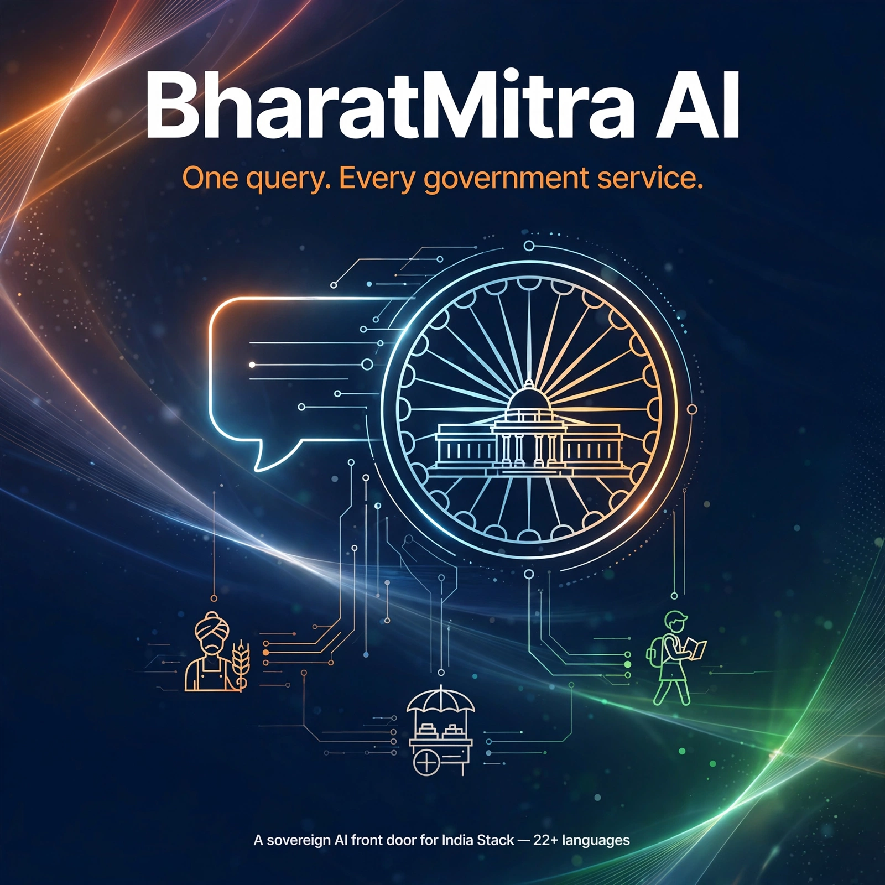
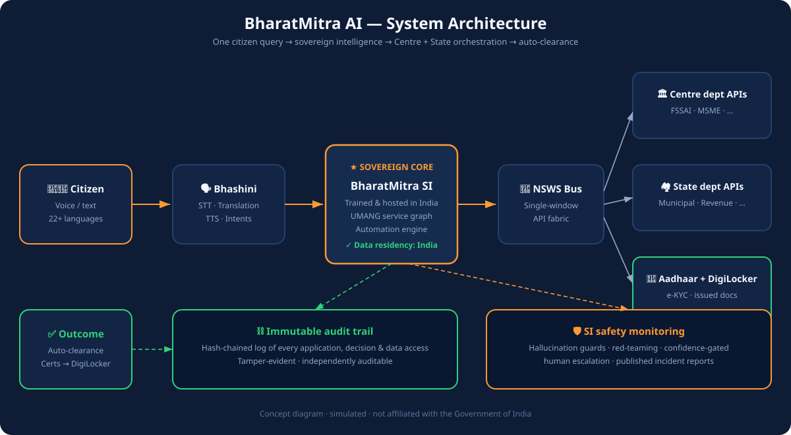

<p align="center">
  
</p>

<h1 align="center">BharatMitra AI 🇮🇳</h1>
<p align="center"><b>One query. Every government service.</b></p>

<p align="center">
  <a href="https://anoop6543.github.io/bharatmitra-ai/"></a>
  
  
  
</p>

<p align="center">
  <a href="#-the-story">Story</a> ·
  <a href="#-what-is-bharatmitra-ai">What it is</a> ·
  <a href="#-live-interactive-demo">Demo</a> ·
  <a href="#-architecture">Architecture</a> ·
  <a href="#-americagov-vs-bharatmitra">vs America.gov</a> ·
  <a href="#-roadmap">Roadmap</a> ·
  <a href="#-references">References</a> ·
  <a href="#-contributing">Contributing</a>
</p>

---

## 📖 The story

On **29 September 2026**, the United States launched **[America.gov](https://techcrunch.com/2026/09/29/can-a-chatbot-fix-the-government-maze-the-white-house-is-about-to-find-out/)** — an AI chatbot unifying ~29,000 federal websites into one conversational "front door," backed by an executive order mandating agency integration. It is a landmark: the first time a major government has declared the chatbot *the* interface to the state.

But look closely, and the gaps are obvious:

- **Information only.** It answers questions; it cannot file, renew, or track anything. Transactions arrive in 2027.
- **Foreign brains.** It runs on Google's Gemini and xAI's Grok — commercial models outside government control.
- **Three languages** of voice. **One level** of government. No answer to discretion, intermediaries, or corruption.

**India can leapfrog all of it — because India already owns the layers America.gov lacks.** Aadhaar's 1.4-billion identity base. DigiLocker's issued-document vault. UMANG's thousands of live services. Bhashini's 22-language voice infrastructure. The NSWS single-window API fabric. UPI's payment rails. No other country holds all of these in one hand.

This repo is the citizen's case for what India should build next — a working interactive demo, a system architecture, and a formal policy proposal.

---

## 💡 What is BharatMitra AI?

**BharatMitra AI** is a proposed national **Sovereign Intelligence (SI)** chatbot for citizen services:

> A citizen speaks or types **one query in any of 22+ languages**. The system **completes the work** — Aadhaar-verified, DigiLocker-powered, orchestrated across Central and State departments via extended NSWS APIs, with **auto-clearance of routine cases**. No forms. No office visits. No intermediaries. No bribes.

### The six layers

| # | Layer | What it does |
|---|-------|--------------|
| 1 | **SI core (sovereign)** | BharatGen-class model, trained & hosted in India. Full data residency — no foreign commercial model in the loop |
| 2 | **Language (Bhashini × UMANG)** | Voice + text in all 22 scheduled languages; UMANG's service catalogue becomes conversational intents |
| 3 | **Integration (extended NSWS bus)** | Central ministries + state departments expose standard APIs; one query fans out as a single cross-tier workflow |
| 4 | **Identity (Aadhaar + DigiLocker)** | Risk-based e-KYC; documents auto-fetched as *issued* records — never uploaded, never forged |
| 5 | **Automation engine** | Criteria fully met → deemed approval within SLA; humans handle only exceptions & appeals |
| 6 | **Trust layer** | Hash-chained immutable audit trail + continuous SI safety monitoring (hallucination guards, red-teaming, human escalation) |

### The ask (from the [full proposal](docs/bharatmitra-ai-proposal.pdf))

1. **PMO / Government of India** — a national mandate establishing BharatMitra AI as the unified AI front door (India's answer to the US executive order, but transactional and sovereign from launch).
2. **Telangana & Andhra Pradesh** — sign on as the two pilot states proving centre-state orchestration first.
3. **MeitY** — constitute the SI safety board; publish API, audit, and auto-clearance standards.

---

## 🖥 Live interactive demo

**👉 https://anoop6543.github.io/bharatmitra-ai/**

No backend — so the frontend carries the full vision. Try these:

1. **🎙 Speak your query** — tap the mic and talk; the demo runs your words through the whole flow (Chrome recommended).
2. **🔊 Hear it reply** — toggle voice replies; the assistant speaks back in Telugu, Hindi, or English via your browser's TTS.
3. **🔀 25 simulated scenarios** — browse all 25 demo chips, or filter 👤 Citizens (17: food-stall approvals, income certificate, DL renewal, passport, Aadhaar update, ration card, pension, scholarship, PM-KISAN, Ayushman, e-Shram, birth & caste certificates, land records, ITR, PF, voter ID) and 🏢 Businesses (8: company incorporation, GST, Udyam, FSSAI, Startup India, GeM, IEC, Shops & Establishments). Every scenario is a **simulated concept flow** — approvals, timings and certificates shown are illustrative, not real.
4. **🌐 Switch languages** — తెలుగు / हिन्दी / English; the service graph is identical in all three.
5. **⚙ Watch the machinery** — the "behind the scenes" panel animates every API step, and the hash-chained audit trail builds live.

Plus, all new in this release:

- **🏢 Business hub** — single-window clearances, deemed approvals, MCA+GSTN+labour in one flow, GeM procurement.
- **💰 Benefits tracker** — Centre/States tabs across 10 major schemes (PM-KISAN, Ayushman, PMAY, MGNREGA, NSAP, PMMVY, Rythu Bharosa, Aasara, Talliki Vandanam, Annadata Sukhibhava). **All figures are illustrative sample data, not official statistics** — the cards link out to the real portals for actual numbers.
- **📊 National progress dashboard** — top-line concept metrics plus six sector cards (agriculture, health, education, MSME, digital, welfare), each with three tracked indicators. Illustrative data, clearly labeled.
- **📚 Service directory** — 25 real government services with **verified official links** (✅), step-by-step "how to do it" guidance, and a "reinvented with BharatMitra" note for each. Where an official URL could not be verified (MeeSeva, T App Folio), the entry shows a clearly marked **🔗 placeholder — the URL is never guessed**.
- **🛡️ Suraksha Kavach** — citizen asset protection on India Stack rails: **Land Vault** (Aadhaar-linked survey-number watch with biometric-consent freeze), **Account Shield** (Account Aggregator dashboard with trusted-contact alerts and senior cooling periods), **Scam Radar** (check any UPI ID/phone/link + 6 common fraud playbooks), **Vaaris** (nominee & succession helper). Includes two working simulators — scam-risk check and land-freeze — both clearly labeled simulated concepts.
- **📚 Paathshala** — audio-first financial literacy in Telugu/Hindi/English: 4 tracks (Seniors 60+, Rural first-time users, Women & SHG, Youth), 8 lessons (OTP safety, UPI rules, nominees, compounding, insurance vs investment, KYC fraud, PMSBY/PMJJBY/APY, reading land records), each with key points, listen-aloud, and a quiz with live score.

Plus: the complete 12-feature vision grid, the six-layer explainer, the architecture diagram, an 18-month roadmap, and the head-to-head comparison — all in one page.

---

## 🏗 Architecture

<p align="center"></p>

**Flow:** Citizen (voice/text, 22+ langs) → Bhashini language layer → BharatMitra SI core (sovereign, India-hosted) → NSWS service bus → Centre dept APIs / State dept APIs / Aadhaar + DigiLocker → auto-clearance → certificates to DigiLocker. Underneath everything: the **immutable audit trail** and **SI safety monitoring**.

---

## 🆚 America.gov vs BharatMitra

| Dimension | America.gov (USA, launched 29 Sept 2026) | BharatMitra AI (proposed) |
|---|---|---|
| Capability at launch | Information only; transactions from 2027 | **Transactional from day one** |
| Intelligence | Foreign commercial models (Gemini, Grok) | **Sovereign Intelligence, hosted in India** |
| Languages | 3 (voice) | **22+ scheduled languages** |
| Identity | Login.gov (future integration) | **Aadhaar + national SSO (universal today)** |
| Documents | Citizen uploads PDFs | **DigiLocker issued docs, auto-fetched** |
| Integration | Federal agencies only | **Centre + States + local via NSWS APIs** |
| Discretion removal | Not addressed | **Auto-clearance + immutable audit** |
| Safety | Hallucination concerns in press coverage | **SI safety monitoring, red-teaming, human escalation** |

---

## 🗺 Roadmap — 18 months to national rollout

| Phase | Window | Milestones |
|---|---|---|
| **0 — Mandate & standards** | Mo 1–3 | National directive; API + audit-trail standards; SI safety board constituted |
| **1 — Core + pilots** | Mo 4–9 | SI core trained & hardened; Telugu/Hindi/English conversational layer; TG & AP onboard 10 high-volume services each |
| **2 — Scale** | Mo 10–15 | All 22 scheduled languages; 500+ services; auto-clearance rules published per department |
| **3 — National rollout** | Mo 16–18 | All states onboarded; in-chat grievance & appeal loop; public SLA + bribe-report dashboard |

---

## 📁 What's in this repo

```
bharatmitra-ai/
├── index.html                  # Interactive demo (static — no build step)
├── data/
│   ├── demos.js                # 25 trilingual simulated demo scenarios
│   ├── services.js             # 25 directory entries (verified links + placeholders)
│   ├── impact.js               # Benefits/sector data (illustrative) + T2 UI strings
│   ├── protect.js              # Suraksha Kavach: 4 protection features, 6 fraud types + T3 UI strings
│   └── learn.js                # Paathshala: 4 tracks, 8 lessons with quizzes + T4 UI strings
├── assets/
│   └── architecture.svg        # System architecture diagram
├── docs/
│   ├── bharatmitra-ai-proposal.pdf   # Formal policy proposal (PMO / TG / AP)
│   └── bharatmitra-ai-proposal.md    # Proposal source
├── social-poster.webp          # Social media poster
├── README.md
└── LICENSE
```

**Run locally:** no build step — open `index.html`, or `python3 -m http.server 8000`.

---

## 🔗 Data & linking policy

- **Verified links only.** Every directory/benefits link was checked against an official government source before publishing. `✅` = verified official link.
- **Placeholders, never guesses.** Where a URL could not be verified (currently MeeSeva and T App Folio), the entry shows a `🔗` placeholder badge — "Official URL verification pending" — and no URL is invented.
- **Illustrative data, labeled.** Benefits-tracker and progress-dashboard figures are sample data for the demo visualisation, marked **"Illustrative concept data — not official statistics"** in the UI. They exist to show what the dashboard *would* look like; real numbers live on the linked portals.
- **Representative catalog.** The 25-entry directory is a representative verified catalog for this static demo; a production system would federate authoritative service registries rather than hard-code links.
- **Language quality.** Telugu and Hindi content in the demo, lessons, and protection flows is draft quality — fluent-speaker review is required before calling it native-polished. (The Paathshala section carries this notice in the UI as well.)

---

## 📚 References

This project builds on the work of many others. Every substantive claim is cited; the demo code itself is hand-written for this repo.

### America.gov — launch reporting (29–30 Sept 2026)

1. TechCrunch — ["Can a chatbot fix the government maze? The White House is about to find out"](https://techcrunch.com/2026/09/29/can-a-chatbot-fix-the-government-maze-the-white-house-is-about-to-find-out/) (29 Sept 2026) — launch announcement; Gemini + Grok models; Phase 2 transactions in 2027.
2. Healthcare IT News — ["Trump launches AI-driven digital front door for the federal government"](https://www.healthcareitnews.com/news/trump-launches-ai-driven-digital-front-door-federal-government) (Sept 2026) — GSA operation, National Design Studio build, executive order establishing the "unified digital front door."
3. SecurityBoulevard — ["America.gov Explained: What It Is, How to Use It, and What Comes Next"](https://securityboulevard.com/2026/09/america-gov-explained-what-it-is-how-to-use-it-and-what-comes-next/) (Sept 2026) — launch scope (29,000 sites), Login.gov integration plan, passport timeline (Dec 2026), IRS/national-security exclusions.
4. The News — ["US launches America.gov, an AI chatbot for navigating federal services"](https://www.thenews.com.pk/amp/1418146-us-launches-americagov-an-ai-chatbot-for-navigating-federal-services) (Sept 2026) — voice in English/Spanish/French, PDF upload Q&A, information-only limits at launch.
5. Herald Business — ["Trump launches US government AI chatbot site, calls it 'preview' of superintelligence"](https://biz.heraldcorp.com/article/10888252) (Sept 2026) — WSJ-sourced detail on planned transactional expansion.
6. Executive Order — *Streamlining Access to Government Services Through America.gov* (29 Sept 2026), as reported in (2) and (3).

### India Stack & national programmes

7. UIDAI — Aadhaar identity platform — [uidai.gov.in](https://uidai.gov.in)
8. DigiLocker — issued-document vault — [digilocker.gov.in](https://www.digilocker.gov.in)
9. UMANG — Unified Mobile Application for New-age Governance — [web.umang.gov.in](https://web.umang.gov.in)
10. Bhashini — National Language Translation Mission — [bhashini.gov.in](https://bhashini.gov.in)
11. NSWS — National Single Window System — [nsws.gov.in](https://www.nsws.gov.in)
12. Digital India programme — [digitalindia.gov.in](https://www.digitalindia.gov.in)
13. The Digital Personal Data Protection Act, 2023 (MeitY) — consent-based data governance frame.
14. BharatGen — Department of Science & Technology sovereign AI initiative (June 2026) — the "SI core" reference model for this proposal.
15. NPCI / UPI — [npci.org.in](https://www.npci.org.in) — payment rails referenced for in-chat fee collection.
16. ONDC — [ondc.org](https://ondc.org) — open-protocol inspiration for the service-bus design.

### This repo's own documents

17. *BharatMitra AI: A Sovereign, Transactional National Single-Window for India's Citizen Services* — policy proposal to the PMO (India), CMO Telangana, CMO Andhra Pradesh (30 Sept 2026) — [`docs/bharatmitra-ai-proposal.pdf`](docs/bharatmitra-ai-proposal.pdf).

> If we missed a citation or misrepresented a source, please open an issue — crediting correctly matters.

---

## 🤝 Contributing

Ideas, corrections, and better demo scenarios are welcome:

- **New scenario?** The demo engine is data-driven — add a language-keyed entry to the `T` object in `index.html` (query, intro, steps, cert) and a chip button. No backend needed.
- **Better Telugu/Hindi?** Native speakers: please PR fixes to the demo strings.
- **Design polish?** It's one static file — easy to improve.

---

## 📄 License

MIT — see [LICENSE](LICENSE). The proposal text may be shared and quoted freely with attribution.

## ⚖️ Disclaimer

Citizen concept demo. Not affiliated with the Government of India. All identities, documents, departments, and transactions in the demo are simulated. Budget figures in the proposal are the author's estimates.

---

<p align="center">Prepared by <b>Viswa Anoop Nerella</b> · September 2026 · Hyderabad, India 🇮🇳</p>
<p align="center"><i>America launched the front door yesterday. India can open a better one.</i></p>
